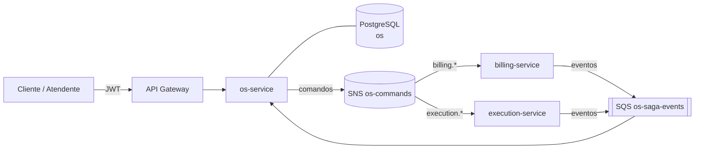

# 🔧 auto-repair-os-service

Microsserviço de **Ordem de Serviço (OS)** da oficina. É dono do cadastro
(clientes, veículos, serviços, peças), do ciclo de vida da OS e do
**orquestrador da saga** que coordena orçamento/pagamento
([billing-service](https://github.com/soat-fiap-rferrazrodrigues/auto-repair-shop-billing-service))
e execução
([execution-service](https://github.com/soat-fiap-rferrazrodrigues/auto-repair-shop-execution-service)).

| Entrega | Onde |
|---|---|
| Código-fonte | `src/` |
| Dockerfile | [`Dockerfile`](Dockerfile), [`docker-compose.yml`](docker-compose.yml) |
| Manifestos Kubernetes | [`k8s/`](k8s) (aplicados pelo pipeline) |
| Pipeline CI/CD | [`.github/workflows/ci-cd.yml`](.github/workflows/ci-cd.yml) |
| Cobertura de testes | [seção Qualidade](#qualidade-e-cobertura-de-testes) |
| Arquitetura | [seção Arquitetura](#arquitetura) e [`docs/`](docs/README.md) (ADRs, RFCs, diagramas) |
| API | Swagger em `/api/docs` · Postman em [`docs/postman/`](docs/postman) |

## Arquitetura

### Papel no sistema



- **Banco próprio:** PostgreSQL (dados relacionais de cadastro e OS, relatórios com JOIN). Nenhum outro serviço acessa esse banco ([ADR-006](docs/adr/ADR-006-bancos-por-servico.md)).
- **Comunicação:** REST para clientes; SNS/SQS entre serviços ([ADR-005](docs/adr/ADR-005-mensageria-sns-sqs.md)).
- **Saga orquestrada** ([ADR-004](docs/adr/ADR-004-saga-orquestrada.md)): o `OrderSagaOrchestrator` envia comandos e reage a eventos, aplicando compensações.

### Por que saga orquestrada (e não coreografada)
O fluxo da OS é linear e já era uma máquina de estados. Com o orquestrador na OS,
o estado da saga fica num único lugar (a própria OS) e as compensações ficam
centralizadas; na coreografia o rollback ficaria espalhado em três repositórios.
Detalhes e trade-offs no [ADR-004](docs/adr/ADR-004-saga-orquestrada.md).

### Fluxo da saga

| Evento recebido | Ação do orquestrador |
|---|---|
| `send-budget` (REST) | OS → `AWAITING_APPROVAL`, comando `billing.GenerateBudget` |
| `BudgetApproved` (REST/webhook de e-mail) | OS → `AWAITING_PAYMENT`, comando `billing.CreatePayment` |
| `PaymentConfirmed` | OS → `IN_EXECUTION`, comando `execution.ReserveAndEnqueue` |
| `ExecutionFinished` | OS → `FINISHED` |
| `BudgetRejected` | **compensação:** OS → `RECEIVED` |
| `BudgetFailed` / `PaymentFailed` | **compensação:** OS → `CANCELLED` |
| `StockUnavailable` | **compensação:** `billing.RefundPayment` + OS → `CANCELLED` |

Diagramas de sequência (caminho feliz e compensação) em
[`docs/diagrams/sequence-diagrams.md`](docs/diagrams/sequence-diagrams.md).

### Fluxo de status da OS

```
RECEIVED → IN_DIAGNOSIS → AWAITING_APPROVAL → AWAITING_PAYMENT → IN_EXECUTION → FINISHED → DELIVERED
                                   │                  │                │
                                   └→ RECEIVED        └→ CANCELLED     └→ CANCELLED
```

- Transições inválidas são rejeitadas (`STATUS_FLOW`); eventos duplicados ou fora de ordem são ignorados (idempotência).
- O estoque **não** é baixado aqui: a reserva é feita pelo execution-service após o pagamento.

### Camadas

```
src/
├── auth/          # JWT (HS256, compartilhado com a Lambda de CPF), guards de papel
├── clients/ vehicles/ services/ parts/   # cadastros (controller → service → repository)
├── orders/
│   ├── use-cases/ # regras da OS (criar, mudar status, listar, acompanhar)
│   └── saga/      # orquestrador, consumidor SQS, eventos e teste BDD
├── reports/       # tempo médio, OS por status, dashboard
└── common/        # mensageria (SNS), logger JSON + correlation_id, middleware
```

### Observabilidade
Logs JSON com `correlation_id` (= `orderId` nas mensagens da saga), traces APM
(dd-trace) e monitores/dashboard do Datadog definidos no repositório de infra.

## Execução local

```bash
cp .env.example .env
docker compose up --build        # API + PostgreSQL
# API:     http://localhost:3000
# Swagger: http://localhost:3000/api/docs
```

Sem as variáveis `SAGA_SNS_TOPIC_ARN`/`SAGA_SQS_QUEUE_URL` os comandos da saga
são apenas logados (útil para desenvolvimento sem AWS).

## Qualidade e cobertura de testes

```bash
npm test             # unitários + BDD
npm run test:bdd     # só o BDD (jest-cucumber)
npm run test:cov     # cobertura (falha abaixo de 80%)
npm run test:e2e     # e2e com PostgreSQL
```

**Cobertura atual** (`npm run test:cov`, 237 testes):

| Statements | Branches | Functions | Lines |
|---|---|---|---|
| 98,59% | 83,24% | 97,10% | 98,66% |

- **BDD:** [`src/orders/saga/features/order-saga.feature`](src/orders/saga/features/order-saga.feature) — 4 cenários da saga (caminho feliz, rejeição, falha de pagamento, estoque indisponível com estorno).
- **Evidências:** cada execução do pipeline publica a tabela de cobertura no *Job Summary* e o relatório HTML no artefato `coverage-report`; a análise e o quality gate ficam no SonarQube.

<!-- Substitua pelos prints/links da sua execução:


-->

## CI/CD

`lint → build → testes (unit + BDD, cobertura ≥ 80%) → e2e → SonarQube (quality gate) → imagem (GHCR) → deploy no EKS`

- Deploy aplica os manifestos de [`k8s/`](k8s), roda as migrations e faz o rollout.
- `homolog`: automático · `main` (produção): aprovação manual no GitHub Environment.
- Branch `main` protegida: exige PR e o check `Build, Test & Quality`.

## Endpoints principais

Documentação completa e interativa no Swagger (`/api/docs`).

### Auth (público)
| Método | Rota | Descrição |
|--------|------|-----------|
| POST | `/auth/register` | Registrar usuário admin |
| POST | `/auth/login` | Login (retorna JWT) |

### Clientes (autenticado)
| Método | Rota | Descrição |
|--------|------|-----------|
| POST | `/clients` | Cadastrar cliente |
| GET | `/clients` | Listar clientes |
| GET | `/clients/search?cpfCnpj=` | Buscar por CPF/CNPJ |
| GET | `/clients/:id` | Detalhar cliente |
| PATCH | `/clients/:id` | Atualizar cliente |
| DELETE | `/clients/:id` | Remover cliente |

### Veículos (autenticado)
| Método | Rota | Descrição |
|--------|------|-----------|
| POST | `/vehicles` | Cadastrar veículo |
| GET | `/vehicles` | Listar veículos |
| GET | `/vehicles/:id` | Detalhar veículo |
| PATCH | `/vehicles/:id` | Atualizar veículo |
| DELETE | `/vehicles/:id` | Remover veículo |

### Serviços (autenticado)
| Método | Rota | Descrição |
|--------|------|-----------|
| POST | `/services` | Cadastrar serviço |
| GET | `/services` | Listar serviços |
| PATCH | `/services/:id` | Atualizar serviço |
| DELETE | `/services/:id` | Remover serviço |

### Peças e Insumos (autenticado)
| Método | Rota | Descrição |
|--------|------|-----------|
| POST | `/parts` | Cadastrar peça |
| GET | `/parts` | Listar peças (com estoque) |
| PATCH | `/parts/:id` | Atualizar peça/estoque |
| DELETE | `/parts/:id` | Remover peça |

### Ordens de Serviço
| Método | Rota | Descrição |
|--------|------|-----------|
| POST | `/orders` | Criar OS (orçamento calculado) |
| GET | `/orders` | Listar OS |
| GET | `/orders/:id` | Detalhar OS |
| POST | `/orders/:id/start-diagnosis` | `RECEIVED → IN_DIAGNOSIS` |
| POST | `/orders/:id/send-budget` | `→ AWAITING_APPROVAL` e inicia a saga |
| POST | `/orders/:id/approve-budget` | `→ AWAITING_PAYMENT` (cobrança no Mercado Pago) |
| POST | `/orders/:id/reject-budget` | `→ RECEIVED` (compensação) |
| POST | `/orders/:id/finish` | `IN_EXECUTION → FINISHED` |
| POST | `/orders/:id/deliver` | `FINISHED → DELIVERED` |
| PATCH | `/orders/:id/status` | [Admin] correção manual de status |
| GET | `/orders/:id/track` | Acompanhamento (admin ou cliente dono) |
| POST | `/orders/webhook/email` | **Público** — aprovação/rejeição por e-mail |

### Relatórios (autenticado)
| Método | Rota | Descrição |
|--------|------|-----------|
| GET | `/reports/average-time` | Tempo médio de execução |
| GET | `/reports/orders-by-status` | OS por status |
| GET | `/reports/dashboard` | Dashboard completo |

## Variáveis de ambiente

| Variável | Padrão | Descrição |
|----------|--------|-----------|
| DATABASE_HOST / PORT / USER / PASSWORD / NAME | localhost / 5432 / postgres / postgres / auto_repair | PostgreSQL |
| JWT_SECRET | default-secret | Segredo HS256 (o mesmo da Lambda e dos outros serviços) |
| PORT | 3000 | Porta HTTP |
| AWS_REGION | — | Região AWS |
| SAGA_SNS_TOPIC_ARN | — | Tópico de comandos da saga (vazio = só loga) |
| SAGA_SQS_QUEUE_URL | — | Fila de eventos da saga (vazio = sem consumidor) |
| AWS_ENDPOINT_URL | — | Endpoint alternativo (LocalStack) |
| DD_SERVICE / DD_ENV | os-service / local | Tags do Datadog |
