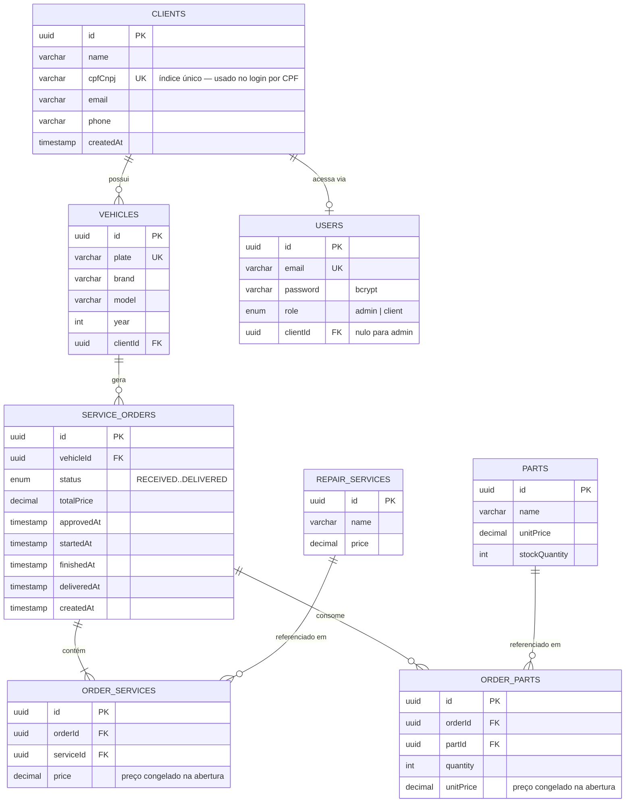

# Modelo de Dados e Justificativa do Banco

## 1. Justificativa formal: PostgreSQL gerenciado (Amazon RDS)

### Natureza do domínio
O núcleo do sistema é a **Ordem de Serviço (OS)**, que envolve operações
inerentemente transacionais e com forte integridade referencial:

- A abertura da OS grava, no mesmo instante, a ordem, seus itens de serviço e
  suas peças. Uma falha parcial produziria orçamento incorreto — exige **ACID**.
- A aprovação do orçamento faz **baixa de estoque** de peças. Sem transação, há
  risco de estoque negativo ou de peça baixada sem OS correspondente.
- Os relatórios (tempo médio por status, volume diário) dependem de agregações
  relacionais com `JOIN` e `GROUP BY` sobre dados normalizados.

### Comparação considerada

| Critério | PostgreSQL | MySQL | DynamoDB (NoSQL) |
|---|---|---|---|
| Transações multi-tabela | ✅ Nativo, robusto | ✅ Adequado | ⚠️ Limitado e custoso |
| Integridade referencial | ✅ FKs e constraints | ✅ | ❌ Aplicação assume |
| Agregações analíticas | ✅ CTEs, window functions | ⚠️ Mais limitado | ❌ Exige ETL |
| Tipos ricos (ENUM, JSONB) | ✅ | ⚠️ Parcial | ✅ Schemaless |
| Ecossistema TypeORM | ✅ Suporte maduro | ✅ | ⚠️ Não relacional |

### Decisão
Adotado **PostgreSQL 16 em Amazon RDS**, pelos motivos:

1. **Transacionalidade real** para o fluxo OS + itens + baixa de estoque.
2. **Tipos ENUM nativos** que espelham `OrderStatus` sem tabela auxiliar.
3. **Window functions** para o cálculo de tempo médio por status nos relatórios.
4. **Serviço gerenciado**: backup automático, criptografia em repouso,
   Multi-AZ em produção e Performance Insights, sem custo operacional de time.
5. **Continuidade**: a Fase 1 já usava PostgreSQL, evitando migração de dados.

---

## 2. Diagrama Entidade-Relacionamento



## 3. Explicação dos relacionamentos

| Relacionamento | Cardinalidade | Justificativa |
|---|---|---|
| `CLIENTS → VEHICLES` | 1:N | Um cliente pode cadastrar vários veículos |
| `CLIENTS → USERS` | 1:0..1 | Cliente pode ter credencial de acesso; `admin` não tem `clientId` |
| `VEHICLES → SERVICE_ORDERS` | 1:N | Um veículo acumula histórico de ordens ao longo do tempo |
| `SERVICE_ORDERS → ORDER_SERVICES` | 1:N (obrigatório) | Toda OS tem ao menos um serviço; tabela associativa com preço |
| `SERVICE_ORDERS → ORDER_PARTS` | 1:N (opcional) | Nem toda OS consome peças |
| `REPAIR_SERVICES → ORDER_SERVICES` | 1:N | Catálogo referenciado sem duplicar dados |
| `PARTS → ORDER_PARTS` | 1:N | Catálogo com controle de `stockQuantity` |

### Decisão de modelagem: congelamento de preço
`ORDER_SERVICES.price` e `ORDER_PARTS.unitPrice` **duplicam** o valor do catálogo
no momento da abertura. É uma desnormalização deliberada: se o preço do catálogo
mudar, o orçamento histórico da OS permanece auditável e íntegro.

## 4. Ajustes no modelo relacional (Fase 3)

| Ajuste | Motivação |
|---|---|
| Índice único em `clients.cpfCnpj` | O login por CPF consulta essa coluna a cada autenticação |
| Índice composto em `service_orders (status, createdAt)` | A listagem ordena por status e data; evita full scan |
| `deletion_protection` no RDS de produção | Impede destruição acidental via Terraform |
| Substituição de `synchronize: true` por migrations | `synchronize` pode causar perda de dados em produção |
| Exclusão lógica de OS finalizadas na listagem | Requisito funcional, resolvido por filtro de status |

## 5. Índices recomendados

```sql
CREATE UNIQUE INDEX idx_clients_cpf_cnpj ON clients ("cpfCnpj");
CREATE INDEX idx_orders_status_created  ON service_orders (status, "createdAt");
CREATE INDEX idx_orders_vehicle         ON service_orders ("vehicleId");
CREATE INDEX idx_order_services_order   ON order_services ("orderId");
CREATE INDEX idx_order_parts_order      ON order_parts ("orderId");
```
