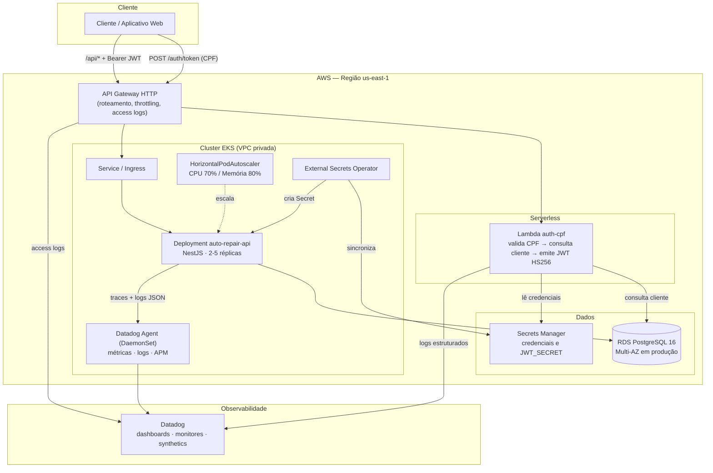
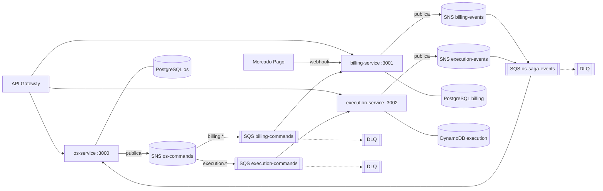

# Diagrama de Componentes

Visão de nuvem da plataforma Auto Repair Shop, incluindo API Gateway, função
serverless de autenticação, cluster Kubernetes, banco gerenciado e observabilidade.



## Responsabilidades

| Componente | Responsabilidade |
|---|---|
| **API Gateway** | Ponto único de entrada, roteamento, throttling e access logs correlacionados |
| **Lambda auth-cpf** | Valida CPF, consulta cliente e emite JWT HS256 (`iss=auto-repair-auth-lambda`) |
| **Deployment API** | Regras de negócio de ordens de serviço, clientes, veículos, peças e serviços |
| **HPA** | Escala horizontal por consumo de CPU e memória |
| **RDS PostgreSQL** | Persistência transacional com backup automático e criptografia |
| **Secrets Manager** | Guarda `JWT_SECRET` e credenciais; nada sensível fica em Git |
| **Datadog Agent** | Coleta métricas de nó/pod, logs JSON e traces APM |

## Contrato de token compartilhado

A Lambda e a API assinam e validam com o **mesmo `JWT_SECRET` (HS256)**.
As claims são mantidas compatíveis em `src/auth/mappers/auth.mapper.ts`:

```json
{
  "sub": "<client-id>",
  "email": "cliente@exemplo.com",
  "role": "client",
  "clientId": "<client-id>",
  "cpf": "52998224725",
  "iss": "auto-repair-auth-lambda"
}
```

## Fase 4 — Microsserviços



Cada serviço acessa somente o próprio banco. As permissões vêm do IAM via IRSA
(ADR-005, ADR-006).
