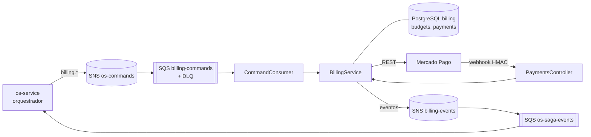

# auto-repair-billing-service

Microsserviço de **orçamento e pagamento** da oficina. Participa da saga
orquestrada pelo `os-service` (ver ADR-004 no repositório da API) e integra com o
**Mercado Pago (Checkout Pro)**.

| Entrega | Onde |
|---|---|
| Código-fonte | `src/` |
| Dockerfile | [`Dockerfile`](Dockerfile), [`docker-compose.yml`](docker-compose.yml) |
| Manifestos Kubernetes | [`k8s/`](k8s) (aplicados pelo pipeline) |
| Pipeline CI/CD | [`.github/workflows/ci-cd.yml`](.github/workflows/ci-cd.yml) |
| Cobertura de testes | [seção Qualidade](#qualidade-e-cobertura-de-testes) |
| Arquitetura | [seção Arquitetura](#arquitetura) |
| API | Swagger em `/docs` · Postman (fluxo completo da saga) em [`docs/postman/`](docs/postman) |

## Arquitetura



| Camada | Arquivos | Responsabilidade |
|---|---|---|
| Entrada assíncrona | `messaging/command.consumer.ts` | Lê comandos do SQS, apaga só após sucesso |
| Entrada HTTP | `billing/payments.controller.ts` | Consulta de pagamento (JWT) e webhook do Mercado Pago (assinatura HMAC) |
| Domínio | `billing/billing.service.ts` | Orçamento, cobrança, confirmação, estorno; idempotência |
| Integração | `mercadopago/mercadopago.client.ts` | Preference, consulta, estorno, validação de assinatura |
| Saída | `messaging/event-publisher.ts` | Publica eventos da saga (SNS) |
| Transversal | `auth/`, `logging/` | JWT HS256 + papéis; logs JSON com `correlation_id` |

**Papel na saga:** participante. Recebe comandos do orquestrador e responde com
eventos; o estorno (`RefundPayment`) é a compensação acionada quando falta estoque.

## Responsabilidades
- Gerar e armazenar o orçamento da OS a partir dos itens enviados pelo os-service.
- Criar a cobrança no Mercado Pago e expor o link de pagamento.
- Receber o webhook do Mercado Pago, validar a assinatura e confirmar o status na API.
- Estornar o pagamento como compensação da saga.

## Banco de dados
PostgreSQL próprio (`budgets`, `payments`). Nenhum outro serviço acessa esse banco.
Os itens da OS chegam no comando `GenerateBudget` com os preços congelados.

## Contrato de mensageria

| Direção | Tipo | Payload |
|---|---|---|
| ⬅ comando | `billing.GenerateBudget` | `{ orderId, items[{kind, referenceId, quantity, unitPrice}], total }` |
| ⬅ comando | `billing.CreatePayment` | `{ orderId }` |
| ⬅ comando | `billing.RefundPayment` | `{ orderId, paymentId }` |
| ➡ evento | `BudgetGenerated` / `BudgetFailed` | `{ orderId, total }` / `{ orderId, reason }` |
| ➡ evento | `PaymentConfirmed` / `PaymentFailed` | `{ orderId, paymentId }` / `{ orderId, reason }` |

**Topologia SNS/SQS:**
- A fila `billing-commands` assina o tópico do os-service com o filtro `{"type":[{"prefix":"billing."}]}`.
- Os eventos vão para o tópico `billing-events`, assinado pela fila de saga do os-service.
- Toda fila tem DLQ (`maxReceiveCount=5`).

**Idempotência:** o SQS entrega cada mensagem ao menos uma vez, então todos os handlers toleram reentrega.
- O orçamento é atualizado por `orderId`.
- A preferência do Mercado Pago não é recriada se já houver uma pendente com o mesmo valor.
- O estorno usa `X-Idempotency-Key=refund-{orderId}`.
- O webhook ignora status repetidos ou já finais.

**Falhas:**
- Falha do Mercado Pago ao criar a cobrança publica `PaymentFailed`, e o orquestrador cancela a OS.
- Falha no estorno é relançada para o SQS reentregar; se persistir, a mensagem vai para a DLQ, que deve ter alarme.

## Endpoints
Documentação interativa no Swagger: `http://localhost:3001/docs`.

| Método | Rota | Acesso | Descrição |
|---|---|---|---|
| GET | `/payments/:orderId` | JWT (`admin`, `client`) | Status, valor e `checkoutUrl` |
| POST | `/payments/webhook` | Público + assinatura `x-signature` | Notificação do Mercado Pago |
| GET | `/health` | Público | Health check (inclui banco) |

## Executar
```bash
cp .env.example .env
docker compose up -d
npm ci && npm run migration:run:dev && npm run start:dev
```

## Qualidade e cobertura de testes

```bash
npm test           # unitários
npm run test:cov   # cobertura (falha abaixo de 80%)
```

**Cobertura atual** (88 testes):

| Statements | Branches | Functions | Lines |
|---|---|---|---|
| 100% | 94,50% | 100% | 100% |

**Evidências:** cada execução do pipeline publica a tabela de cobertura no *Job
Summary* e o relatório HTML no artefato `coverage-report`; análise e quality gate
no SonarQube.

<!-- Substitua pelos prints/links da sua execução:


-->

## CI/CD

`lint → build → testes (cobertura ≥ 80%) → SonarQube (quality gate) → imagem (GHCR) → deploy no EKS`

- `homolog`: deploy automático · `main` (produção): aprovação manual no GitHub Environment.
- Branch `main` protegida: exige PR e o check `Build, Test & Quality`.
- Secrets/variáveis: `SONAR_TOKEN`, `SONAR_HOST_URL`, `AWS_DEPLOY_ROLE_ARN`; variável de environment `API_HOST`.

## Kubernetes

| Arquivo | Conteúdo |
|---|---|
| [`k8s/00-config.yaml`](k8s/00-config.yaml) | ServiceAccount (IRSA), ConfigMap, ExternalSecret (banco, Mercado Pago, JWT), Service |
| [`k8s/10-deployment.yaml`](k8s/10-deployment.yaml) | Deployment (probes, limites, Datadog) e HPA (2–5 réplicas) |

O pipeline preenche `${ACCOUNT_ID}`, `${ENV}`, `${API_HOST}` e `${IMAGE}` com
`envsubst`, aplica a configuração, roda as migrations e faz o rollout. Filas,
tópicos, banco e roles IAM são criados pelo Terraform nos repositórios de infra.
